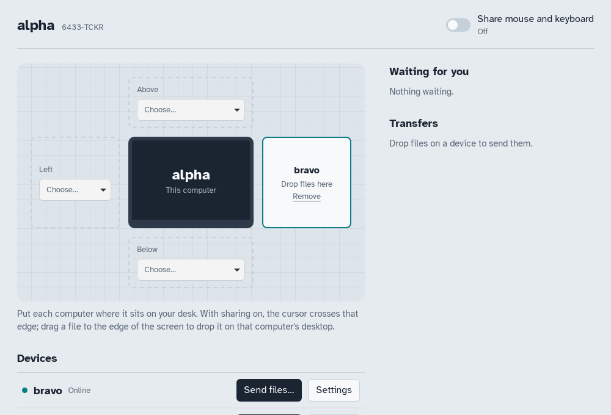

# crossdrop

**A simple, open-source way to share your clipboard and files across devices.**

crossdrop links your computers with direct, end-to-end encrypted connections.
No account, no cloud, no server: devices find each other on the local
network, you pair them once by comparing a 6-digit code, and they talk
peer-to-peer over QUIC.

It is also a **platform**: extensions plug into the same secure links through
a small local API. The first one, **interdesk**, lets one mouse and keyboard
drive every computer on your desk.

> Status: **v0.4, early**. Pairing, files and folders with resume, clipboard
> sharing, **interdesk** (shared mouse and keyboard) and a **desktop app**
> work on the local network. Internet connections are next — see the
> [roadmap](#roadmap).



## Features

- **Zero setup discovery** over mDNS, or connect by `ip:port`.
- **Pairing with a short code** (SAS) derived from the TLS session: a
  man-in-the-middle cannot produce matching codes.
- **Mutual TLS 1.3 over QUIC**, device identities pinned like Syncthing; no
  certificate authority.
- **Per-device, per-service permissions**: a paired device may send you files,
  and nothing else until you allow it.
- **Files and folders**, streamed with constant memory, verified with BLAKE3,
  and **resumed** where they stopped if the connection drops.
- **You decide what comes in**: incoming transfers wait for `crossdrop accept`,
  unless you trust a device to auto-accept.
- **Clipboard sharing** between desktops (opt-in per device), plus
  `crossdrop clip send/get` for headless machines and scripts.
- **Extension API**: register a service, receive authenticated byte streams
  ([docs/extensions.md](docs/extensions.md)).

## Desktop app

The app shows your desk from above: this computer in the middle, the others
where they sit. Pair devices by comparing a code, drop files on a device to
send them, answer incoming files, choose what each device may do, and turn
on mouse and keyboard sharing. If no crossdrop daemon is running, the app
starts one inside itself.

Drag a file to the edge of your screen that faces a neighbour: a yellow zone
opens, drop it there and the file lands on that computer's desktop.

The app logs to `app.log` in the data directory (`~/Library/Application
Support/crossdrop` on macOS, `~/.config/crossdrop` on Linux,
`%APPDATA%\crossdrop` on Windows), including the daemon it runs.

Install it from a [release](https://github.com/root-lr/crossdrop/releases) or
with `brew install --cask crossdrop-app` (see [Install](#install)). To build it:

```sh
cd apps/desktop && npm ci && npm run tauri build
```

## Install

**macOS and Linux, with Homebrew:**

```sh
brew tap root-lr/crossdrop https://github.com/root-lr/crossdrop
brew install crossdrop              # crossdrop, crossdropd, interdesk
brew services start crossdrop       # keep the daemon running
brew install --cask crossdrop-app   # the desktop app (macOS, Apple silicon and Intel)
```

**Windows, macOS, Linux:** installers and command-line archives are attached to
each [release](https://github.com/root-lr/crossdrop/releases).

**From source:** `cargo install --git https://github.com/root-lr/crossdrop crossdrop-cli interdesk`

**Keep the daemon running on Linux** (without Homebrew): a systemd user unit
is in [`packaging/systemd/crossdropd.service`](packaging/systemd/crossdropd.service);
its header says how to install it.

The binaries are not signed yet: Windows shows a SmartScreen warning ("More
info", then "Run anyway"); on macOS, run
`xattr -dr com.apple.quarantine /Applications/crossdrop.app` if it refuses to open.

## Quick start (command line)

On each computer:

```sh
crossdrop daemon            # keep it running (or use a service manager)
```

Then, from computer A:

```sh
crossdrop devices           # bravo  GTDT-W6OV  nearby  192.168.1.20:47470
crossdrop pair bravo        # shows a code, e.g. 387 668
```

On computer B:

```sh
crossdrop accept            # shows the same code; confirm
```

Send files and folders:

```sh
crossdrop send report.pdf ~/Pictures/holidays --to bravo
```

On bravo, `crossdrop accept` (or `crossdrop auto-accept alpha` once). Files
land in `~/Downloads/crossdrop` (configurable in `config.toml`). If the
transfer is cut, run the same command again: it resumes.

Share the clipboard (run on both devices, each naming the other):

```sh
crossdrop allow bravo clipboard     # on alpha
crossdrop allow alpha clipboard     # on bravo
```

Copy on one, paste on the other. To share one way only, run
`crossdrop clip share bravo --off` on the device that keeps its copies to
itself. From a script or a server:
`echo "text" | crossdrop clip send --to bravo`, `crossdrop clip get`.

| Command | What it does |
| --- | --- |
| `crossdrop status` | This device's name, id and port |
| `crossdrop devices` | Paired and nearby devices |
| `crossdrop pair <name \| id \| ip:port>` | Start pairing |
| `crossdrop requests` / `accept` / `reject` | Answer pairing requests and incoming transfers |
| `crossdrop send <files or folders…> --to <device>` | Send, or resume sending |
| `crossdrop auto-accept <device> [--off]` | Trust a device's files without asking |
| `crossdrop clip send [text] [--to device]` / `clip get` | Share text with clipboards |
| `crossdrop clip share <device> [--off]` | Send this device's copies to a device, or stop |
| `crossdrop allow <device> <service>` / `deny` | Manage permissions (`files`, `clipboard`, `input`, or a full name) |
| `crossdrop unpair <device>` | Forget a device |

All commands take `--home <dir>` to use another data directory, handy to run
two daemons on one machine.

Shell completion: `crossdrop completions bash|zsh|fish|powershell|elvish`
prints a script to install where your shell looks for them (see
`crossdrop completions --help`).

## interdesk: one mouse and keyboard for all your computers

```sh
interdesk add bravo right       # on alpha: bravo is to the right of this screen
crossdrop allow alpha input     # on bravo: alpha may drive it
interdesk run                   # on both
```

Push the cursor past alpha's right edge and it continues on bravo, keyboard
included. Ctrl+Alt+Esc brings it back. Linux (X11), Windows and macOS. See
[docs/interdesk.md](docs/interdesk.md).

## How it works

```
CLI / app / extensions ──IPC──▶ crossdropd ══QUIC + TLS 1.3══ crossdropd
```

One daemon per device owns the keys and the connections. Everything else —
the CLI, the desktop app, interdesk — talks to it over a local socket.
Each service gets its own QUIC stream ("channel") on a shared connection.
Details: [docs/protocol.md](docs/protocol.md).

| Crate | Role |
| --- | --- |
| [`crossdrop-proto`](crates/crossdrop-proto) | Wire and IPC messages, framing |
| [`crossdrop-core`](crates/crossdrop-core) | Identity, TLS, QUIC endpoint, channels, mDNS |
| [`crossdrop-daemon`](crates/crossdrop-daemon) | `crossdropd`: trust, permissions, routing, built-in services |
| [`crossdrop-sdk`](crates/crossdrop-sdk) | Client library for the CLI, apps and extensions |
| [`crossdrop-cli`](crates/crossdrop-cli) | The `crossdrop` command |
| [`interdesk`](crates/interdesk) | Shared mouse and keyboard, an extension using only `crossdrop-sdk` |
| [`apps/desktop`](apps/desktop) | Tauri 2 + React desktop app |

## Roadmap

| Version | Scope |
| --- | --- |
| v0.1 ✓ | Identity, pairing, encrypted channels, extension API, file transfer (CLI) |
| v0.2 ✓ | Folders, resumable transfers, accept/decline incoming files, clipboard sync |
| v0.3 ✓ | **interdesk**: shared mouse and keyboard (Windows, macOS, X11) |
| **v0.4** ✓ | Desktop app (Tauri), drag files to a neighbouring screen |
| v0.5 | Connections over the internet: hole punching, self-hostable relay |
| v1.0 | Frozen protocol, signed binaries, published benchmarks |

## Development

```sh
cargo test --workspace      # includes end-to-end tests with two daemons
cargo clippy --workspace --all-targets
```

## License

Licensed under either of [Apache License 2.0](LICENSE-APACHE) or
[MIT license](LICENSE-MIT), at your option.
